<p align="center">
  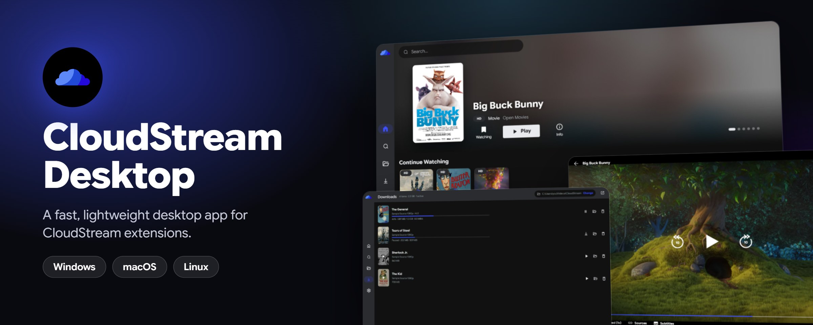
</p>

<p align="center">
  <a href="https://github.com/ahasan-ullah/cloud_stream_pc/releases/latest"></a>
  <a href="https://github.com/ahasan-ullah/cloud_stream_pc/actions/workflows/build.yml"></a>
  
  
  <a href="https://github.com/ahasan-ullah/cloud_stream_pc/stargazers"></a>
</p>

<p align="center">
  <a href="https://github.com/ahasan-ullah/cloud_stream_pc/releases/latest"></a>
  <a href="https://github.com/ahasan-ullah/cloud_stream_pc/releases/latest"></a>
  <a href="https://github.com/ahasan-ullah/cloud_stream_pc/releases/latest"></a>
</p>

> [!WARNING]
> **This app doesn't provide any video sources.** You have to install extensions to add functionality to it, just like the CloudStream Android app.

> [!NOTE]
> CloudStream Desktop is an unofficial, independent project. It is not made or endorsed by the CloudStream team. All credit for CloudStream itself goes to [recloudstream/cloudstream](https://github.com/recloudstream/cloudstream).

## Contents

- [About](#about)
- [Features](#features)
- [Screenshots](#screenshots)
- [Download and install](#download-and-install)
- [How to use it](#how-to-use-it)
- [CloudStream repositories](#cloudstream-repositories)
- [Keyboard shortcuts](#keyboard-shortcuts)
- [Troubleshooting](#troubleshooting)
- [Build it yourself](#build-it-yourself)
- [Credits and thanks](#credits-and-thanks)
- [Disclaimer](#disclaimer)
- [License](#license)

## About

[CloudStream](https://github.com/recloudstream/cloudstream) is a much-loved, extension-based media center for Android. **CloudStream Desktop brings that experience to your computer.** It runs the same `.cs3` extensions, without changes, in an app modelled on the Android layout.

It is built to stay light. There is no bundled browser: the interface runs in the web view already on your system, and images are shrunk before they are displayed. On Windows it used about 450 to 550 MB of RAM after scrolling through around 30 Home categories, and the installer is about 53 MB with its own Java runtime included, so there is nothing else to install.

## Features

<table>
<tr>
<td width="50%" valign="top">

**Extensions**
- Runs CloudStream `.cs3` extensions unchanged
- Add repositories by URL or shortcode
- Automatic plugin updates

**Browse**
- Home with featured titles and categories
- Continue Watching
- Search across all your sources, with filters
- Details with rating, cast, trailers, seasons and episodes
- Random pick when you can't decide

**Library**
- Watching, Plan to Watch, On-Hold, Completed, Dropped
- Watch history and episode progress
- Backup and restore

</td>
<td width="50%" valign="top">

**Player**
- HLS, MP4 and WebM in the app
- Hand off to [mpv](https://mpv.io) for MKV, HEVC and DASH
- Multiple sources, quality and audio tracks
- Subtitles with size, style and delay controls
- Speed control, skip intro, next episode
- Picture-in-picture and fullscreen

**Downloads**
- Direct and HLS downloads, with subtitles
- Pause, resume, and watch offline
- Choose your own downloads folder
- Play any direct link with Network stream

**Yours**
- No ads, no tracking, no account
- 12 accent colors and 3 poster sizes
- Full keyboard control

</td>
</tr>
</table>

## Screenshots

<table>
<tr>
<td width="50%">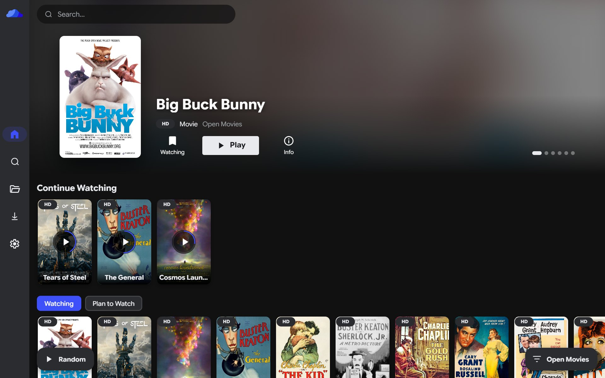<p align="center"><b>Home</b></p></td>
<td width="50%">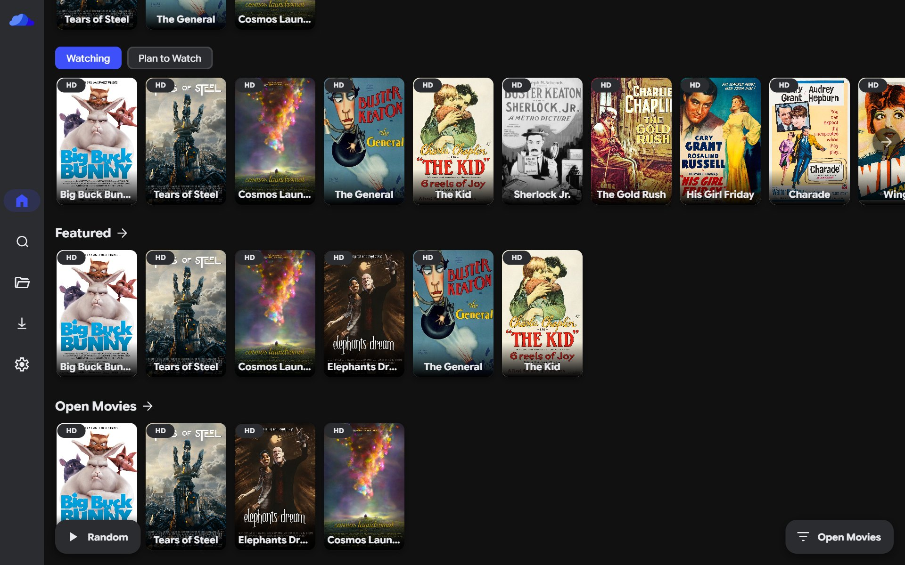<p align="center"><b>Categories</b></p></td>
</tr>
<tr>
<td>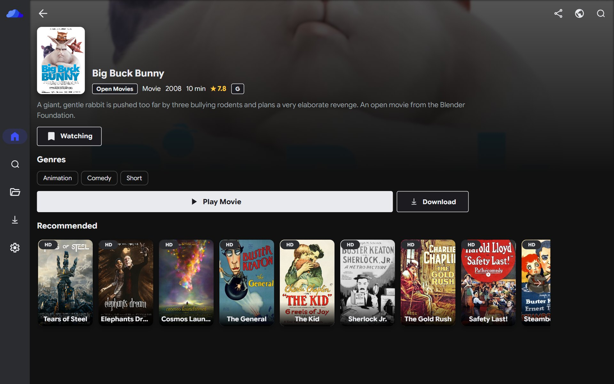<p align="center"><b>Details</b></p></td>
<td>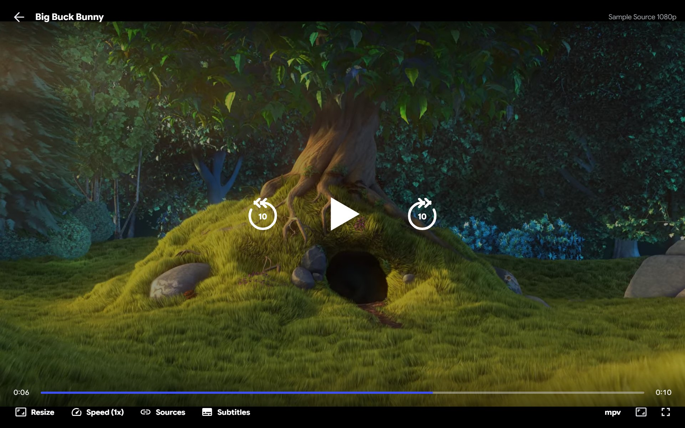<p align="center"><b>Player</b></p></td>
</tr>
<tr>
<td>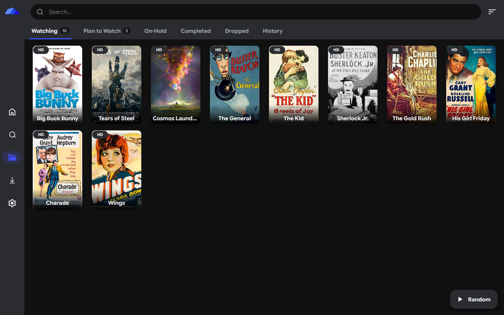<p align="center"><b>Library</b></p></td>
<td>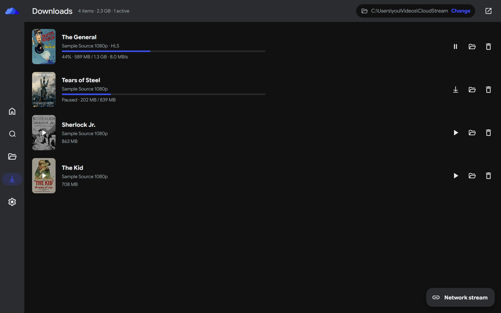<p align="center"><b>Downloads</b></p></td>
</tr>
</table>

<sub>Screenshots show the real app with sample data: open movies from the Blender Foundation and public domain films. The app itself comes with no content. See [image credits](#image-credits).</sub>

## Download and install

Get the latest version from the **[Releases page](https://github.com/ahasan-ullah/cloud_stream_pc/releases/latest)**. You don't need Java or anything else, because everything is included.

> [!IMPORTANT]
> Windows is the tested platform. The macOS and Linux versions are new, so please [open an issue](https://github.com/ahasan-ullah/cloud_stream_pc/issues) if something doesn't work.

<details open>
<summary><b>Windows</b></summary>

1. Download the file ending in `Setup.exe`.
2. Open it. If a blue "Windows protected your PC" screen appears, click **More info**, then **Run anyway**. This appears because the app isn't code-signed.
3. Follow the installer. It doesn't need admin rights.

There is also an `.msi` file if you prefer that.

</details>

<details>
<summary><b>macOS</b></summary>

1. Download the `.dmg` for your Mac: `Apple-Silicon` for M1 and newer, `Intel` for Intel.
2. Open it and drag **CloudStream Desktop** into **Applications**.
3. Open the app. If macOS blocks it, go to **System Settings → Privacy & Security** and click **Open Anyway**.

If macOS says the app is damaged, run this in Terminal and open it again:

```bash
xattr -cr "/Applications/CloudStream Desktop.app"
```

</details>

<details>
<summary><b>Linux</b></summary>

Download the file for your system, then run the matching command from the folder it's in:

```bash
# Ubuntu, Debian, Linux Mint
sudo apt install ./CloudStream*.deb

# Fedora, RHEL
sudo dnf install ./CloudStream*.rpm
```

If videos don't play, install the video codecs. On Ubuntu and Debian:

```bash
sudo apt install gstreamer1.0-plugins-good gstreamer1.0-plugins-bad gstreamer1.0-libav
```

</details>

## How to use it

### 1. Add a repository

The app starts empty, so this is the first thing to do. Open **Settings → Extensions**, click **Add repository**, paste a repository URL or shortcode, and click **Add**. See [CloudStream repositories](#cloudstream-repositories) for where to find one.

<p align="center">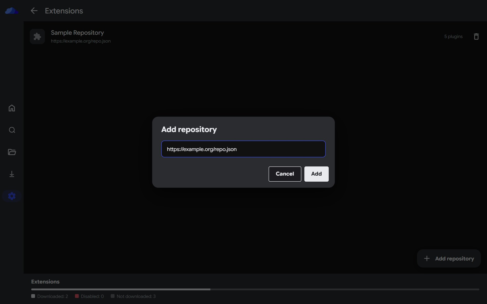</p>

> [!CAUTION]
> Extensions are code that runs on your computer, and they are not sandboxed. Only add repositories you trust.

### 2. Install extensions

Click the repository to see what it offers, then click the download icon next to each extension you want. Filters at the top narrow the list by type.

<p align="center">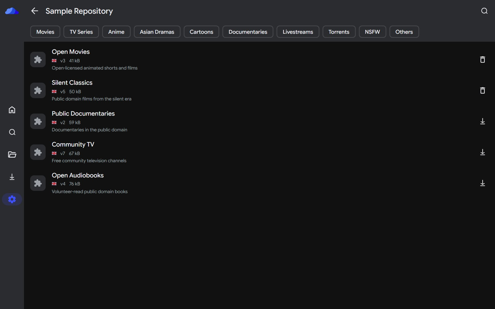</p>

### 3. Browse

Go to **Home** to see what your extension offers. The button in the bottom-right corner switches between sources, and **Random** picks something for you.

<p align="center"></p>

### 4. Search

Press <kbd>Ctrl</kbd> + <kbd>F</kbd> (<kbd>⌘</kbd> + <kbd>F</kbd> on a Mac) or click the search icon. Results are grouped by source, and the chips below the search bar filter by type.

<p align="center">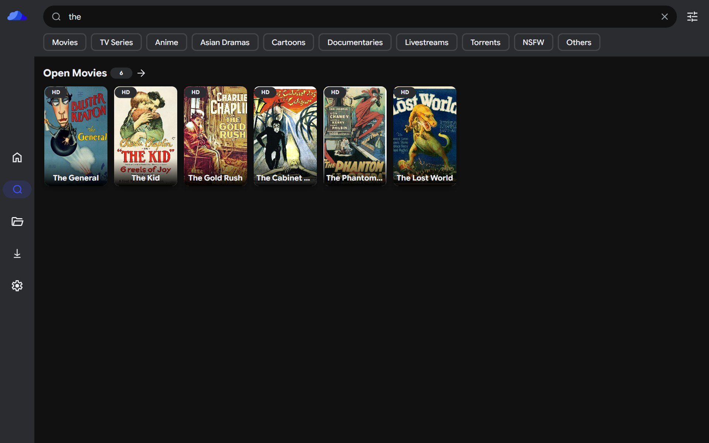</p>

### 5. Watch

Open a title and click **Play**. Your progress is saved, so it shows up in **Continue Watching** on Home. If a stream doesn't load, open **Sources** in the player and pick another one.

<p align="center"></p>

### 6. Download

Click **Download** on a title and choose a source.

<p align="center">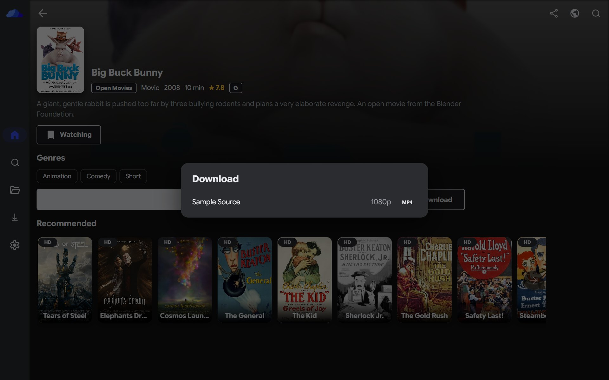</p>

Follow the progress on the **Downloads** page, where you can pause, resume and play finished files. To save somewhere else, click **Change** at the top of the page, or go to **Settings → General → Downloads folder**.

<p align="center"></p>

### 7. Make it yours

- **Library:** bookmark a title on its details page to sort it into Watching, Plan to Watch and so on.
- **Appearance:** choose an accent color and poster size in **Settings → Layout**.
- **Backup:** save your library, history, settings and plugin list in **Settings → Updates and Backup**.
- **Network stream:** to play a direct `.m3u8` or `.mp4` link, click **Network stream** on the Downloads page.

## CloudStream repositories

Extensions come from repositories, which the CloudStream community maintains. This project doesn't host or choose any of them. Start here:

| Link | What it is |
|---|---|
| [**recloudstream/cs-repos**](https://github.com/recloudstream/cs-repos) | Community CloudStream plugin repositories, with a [full list](https://rentry.org/cs3-repos) |
| [**Repositories page**](https://recloudstream.github.io/csdocs/repositories/) | The list in the CloudStream docs, also linked from the Extensions screen |
| [**recloudstream/extensions**](https://github.com/recloudstream/extensions) | A collection of extensions in the CloudStream organization |

Other CloudStream projects:

| Link | What it is |
|---|---|
| [**recloudstream/cloudstream**](https://github.com/recloudstream/cloudstream) | The original CloudStream app for Android |
| [**CloudStream docs**](https://recloudstream.github.io/csdocs/) | Guides for using CloudStream ([source](https://github.com/recloudstream/csdocs)) |
| [**recloudstream/TestPlugins**](https://github.com/recloudstream/TestPlugins) | Template for making your own plugin repository |
| [**recloudstream/gradle**](https://github.com/recloudstream/gradle) | Gradle plugin used to build extensions |

## Keyboard shortcuts

Press <kbd>?</kbd> in the app to see this list at any time.

| Shortcut | Action |
|---|---|
| <kbd>Ctrl</kbd>/<kbd>⌘</kbd> + <kbd>F</kbd> | Search |
| <kbd>Esc</kbd>, <kbd>Alt</kbd> + <kbd>←</kbd> or mouse back button | Back |
| <kbd>Space</kbd> or <kbd>K</kbd> | Play or pause |
| <kbd>←</kbd> <kbd>→</kbd> or <kbd>J</kbd> <kbd>L</kbd> | Rewind or fast forward |
| <kbd>↑</kbd> <kbd>↓</kbd> or mouse wheel | Volume |
| <kbd>M</kbd> | Mute |
| <kbd>F</kbd> or double-click | Fullscreen |
| <kbd>S</kbd> | Skip intro |
| <kbd>N</kbd> | Next episode |
| <kbd>P</kbd> | Picture-in-picture |
| <kbd>[</kbd> <kbd>]</kbd> | Subtitle delay by 0.5 seconds |

## Troubleshooting

<details>
<summary><b>Home is empty</b></summary>

You haven't installed an extension yet. Follow steps 1 and 2 of [How to use it](#how-to-use-it).

</details>

<details>
<summary><b>An extension won't load</b></summary>

Some extensions depend on Android-only features, such as web view Cloudflare bypasses or custom screens, and those can't run on a computer. The error appears on the Extensions page, and your other extensions keep working.

</details>

<details>
<summary><b>A video won't play</b></summary>

Open **Sources** in the player and try another one. The built-in player handles MP4, WebM and HLS. For MKV, HEVC and DASH, install [mpv](https://mpv.io/installation/) and click **mpv** in the player, or turn on **Settings → Player → Always play in mpv**.

</details>

<details>
<summary><b>"CloudStream engine unavailable"</b></summary>

Click **Retry connection**, or go to **Settings → Providers** and click **Restart**. If it keeps happening, the error names a log file called `engine.log`. Please attach it when you [open an issue](https://github.com/ahasan-ullah/cloud_stream_pc/issues).

</details>

## Build it yourself

You need [Rust](https://rustup.rs), [Node.js](https://nodejs.org) 20 or newer, and JDK 17.

```bash
cd engine
./gradlew shadowJar bundleJre
cd ../app
npm install
npm run tauri build -- --config src-tauri/tauri.release.conf.json
```

Each version has to be built on its own operating system. [GitHub Actions](.github/workflows/build.yml) builds all of them, and you can read about the architecture, the Android compatibility layer and the engine API in [docs/DEVELOPMENT.md](docs/DEVELOPMENT.md).

## Credits and thanks

**A huge thank you to the [CloudStream team and contributors](https://github.com/recloudstream/cloudstream/graphs/contributors).** This app wouldn't exist without their work: it runs their `library` module and extractors, loads the extensions built for their app, and takes its design, icons, logo and text from CloudStream. If you enjoy this app, please [star the original project](https://github.com/recloudstream/cloudstream) and support them.

This project is also built on:

- [Tauri](https://tauri.app), [Svelte](https://svelte.dev) and [Rust](https://www.rust-lang.org) for the app
- [Kotlin](https://kotlinlang.org), [Ktor](https://ktor.io) and [dex2jar](https://github.com/ThexXTURBOXx/dex2jar) for the engine
- [hls.js](https://github.com/video-dev/hls.js) and [mpv](https://mpv.io) for playback
- [Google Sans Flex](https://fonts.google.com/specimen/Google+Sans+Flex) (OFL) and [Twemoji](https://github.com/jdecked/twemoji) flags

### Image credits

The sample data in the screenshots comes from these sources, via [Wikimedia Commons](https://commons.wikimedia.org):

- Posters for *Big Buck Bunny* and *Tears of Steel* (CC BY 3.0), and *Elephants Dream* and *Cosmos Laundromat* (CC BY 4.0), by the [Blender Foundation](https://studio.blender.org/films/) and contributors.
- The video frame from *Big Buck Bunny* (CC BY 3.0), by the Blender Foundation.
- All other posters are in the public domain.

## Disclaimer

This app doesn't host, store or distribute any media, and it comes with no extensions or sources. What you install and watch is your own responsibility.

As the CloudStream project asks: **please don't create illegal extensions or use any that host copyrighted media.** Extension repositories are maintained by third parties, and they are not reviewed or endorsed by this project.

## License

Icons, the logo and text in this app come from [CloudStream](https://github.com/recloudstream/cloudstream) (GPL-3.0), so this project is distributed under the [GNU General Public License v3.0](https://www.gnu.org/licenses/gpl-3.0.html).
